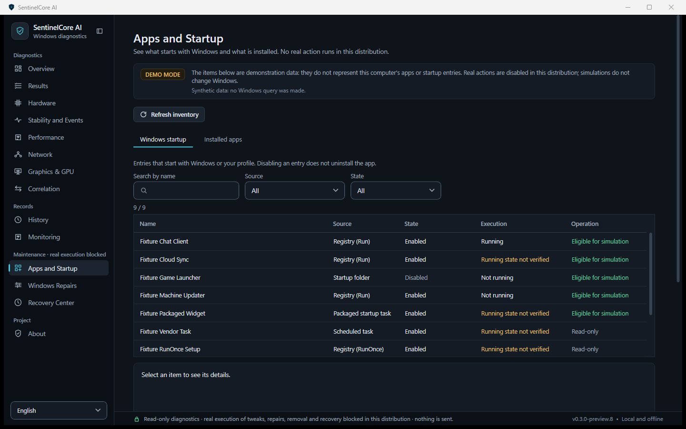
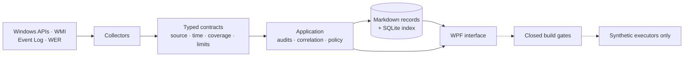

<div align="center">

# SentinelCore AI

**Evidence-first diagnostics for Windows 11.**<br/>
Local by default. Read-only by design. Honest about what it does not know.

<br/>


[Preview](#preview) · [Features](#key-features) · [How it works](#how-it-works) · [Getting started](#getting-started) · [Languages](#languages) · [Limitations](#safety-and-current-limitations) · [License](#license)

</div>

<br/>

> [!IMPORTANT]
> **SentinelCore AI is a preview.** The diagnostic pages are built to read real Windows data and never change it.
> The maintenance pages (Apps & Startup, Repairs) are implemented in code, but real execution is
> **closed by build gates** and the app only demonstrates them with clearly marked synthetic data. Real-world
> validation of those operations has not been done. There is no installer and no public release yet.

## Preview

<p align="center">
  
</p>

<p align="center"><sub>The Apps and Startup page in English. Every entry shown is synthetic demonstration data, not this computer's apps; no Windows query is made and real actions are disabled.</sub></p>

## Why SentinelCore AI?

Windows already records almost everything that goes wrong. The hard part is reading it without turning noise into
conclusions. SentinelCore AI is built to answer questions like *"did this machine log anything relevant in the last
day?"*, *"what changed since the last hardware snapshot?"* or *"was this session worse than the previous one, and on
which evidence?"* and then to show the record behind every answer: its source, timestamp, duration, coverage and
limitations.

Four ideas shape the whole product:

- **Evidence, not opinion.** Every conclusion traces back to a technical record. Correlation is not causality, and
  a missing relation does not prove a missing problem.
- **Local and transparent.** No telemetry, no external API, no data leaves the machine. Information Windows will not
  give a standard user becomes a declared limitation, never a reason to bypass permissions.
- **Durable history.** Immutable Markdown records are the source of truth; the SQLite index can always be rebuilt.
  Nothing is rewritten or deleted automatically.
- **Honest about limits.** Partial coverage, cancellation and unavailability are explicit states. A missing value
  means *unavailable*, never zero, and an indeterminate result is never reported as success.

> The "AI" in the name is a **future** direction, deliberately last in the queue. Today the product contains no LLM
> call, no AI API and no remote processing.

## Key Features

The left menu groups the pages as Diagnostics (Overview to Compare), Records (History, Monitoring), Maintenance
(Apps & Startup, Repairs, Recovery Center) and Project (About).

**Diagnose**

- **Overview and Results.** Basic and full audits with explicit confirmation, progress, cancellation and per-type
  validity, plus the evidence of the last audit grouped by category.
- **Hardware.** Eleven categories from CPU and memory to drivers, with snapshot comparison.
- **Stability and Events.** Windows Event Log and Windows Error Reporting metadata over 24-hour, 7-day, 30-day or
  custom windows.
- **Graphics and GPU.** Adapters, monitors, drivers, display events, TDR and WER metadata.

**Observe over time**

- **Performance.** Short sessions (30 seconds to 3 minutes) covering CPU, memory, processes and storage, with
  execution and coverage tracked separately.
- **Network.** TCP/UDP endpoints and transport statistics. No packet capture, and remote addresses are omitted by
  default.
- **Monitoring.** Authorized 5, 15 or 30-minute sessions with checkpoints and manual incident notes.

**Understand**

- **Correlation.** A timeline and deterministic relations across history already on disk, each with its rule and
  rationale.
- **History.** Every audit saved on this machine, reopenable at any time.

**Maintain (gated)**

- **Apps & Startup.** Startup entries and installed apps with individual preview and typed confirmation.
- **Windows Repairs.** A closed catalog around SFC, DISM, CHKDSK and WinRE, built for an isolated privileged broker.

**Recover**

- **Recovery Center.** One view over the history of every operation, with integrity checks, conflict detection and
  interrupted-operation lookup. It is read-only. Records written by the former Personalization page stay readable
  here; that page is no longer part of the app.

**About**

- **About.** Version and preview status read from the assembly metadata, build, technologies, the
  `MIT OR Apache-2.0` license with third-party notices, and the project link. It makes no network request on its
  own: links open only when you click them.

## How It Works



Layers are acyclic. **Domain** defines contracts, **Application** orchestrates and enforces validity,
**Infrastructure** collects, **Persistence** stores, and **App** only presents. The WPF app never issues a WMI query
itself.

Everything the app stores lives under `%LOCALAPPDATA%\SentinelCoreAI\`: immutable Markdown records with SHA-256,
human-readable reports, a rebuildable SQLite index (schema 12) and logs. Nothing is encrypted, so protection depends
on your Windows profile permissions, and SHA-256 detects accidental corruption, not deliberate tampering.

## Technology Stack

| | |
| --- | --- |
| **Language and runtime** | C# on .NET 10, Windows x64 |
| **Interface** | WPF, native, dark blue / graphite / cyan identity, software rendering by default |
| **Storage** | Immutable Markdown records plus a SQLite index through `Microsoft.Data.Sqlite` |
| **Windows data** | WMI and the Event Log through `System.Management` and `System.Diagnostics.EventLog` |
| **Architecture** | Layered projects with explicit contracts and no circular references |
| **Tests** | xUnit, with an audited selection of synthetic tests |
| **Build** | Locked NuGet restore (`packages.lock.json`) and a pinned SDK in `global.json` |

## Getting Started

**Requirements:** Windows 11 x64 and the .NET SDK pinned in [`global.json`](global.json) (10.0.403). The app runs as
a standard user and never asks for elevation.

Build with locked dependencies:

```powershell
dotnet restore SentinelCore.sln --locked-mode
dotnet build SentinelCore.sln -c Debug --no-restore
dotnet build SentinelCore.sln -c Release --no-restore
```

A Release build lands in `src/SentinelCore.App/bin/Release/net10.0-windows10.0.22621.0/` (the app's target framework
moniker); `SentinelCoreAI.exe` there is a framework-dependent build, not the self-contained package from
`scripts/publish.ps1`.

Run from source. Maintenance pages show synthetic data only, so this does not change your system:

```powershell
dotnet run --project src/SentinelCore.App
```

To keep a session away from your real history, point the app at an isolated data root (an absolute local path):

```powershell
dotnet run --project src/SentinelCore.App -- --data-root D:\isolated\root
```

### Tests

The test project mixes synthetic tests with tests that query a real Windows installation, so **do not run the whole
suite with `dotnet test`**. Use the audited runner, which selects test methods positively, verifies source hashes and
checks every selected result:

```powershell
$cases = (Get-Content -Raw -Encoding UTF8 .\tests\synthetic-audit.json | ConvertFrom-Json).synthetic
.\tests\run-synthetic.ps1 -Configuration Release -Cases $cases
```

Passing synthetic tests shows that the code behaves as designed. It does not validate real Windows operations.

### Publishing

`scripts/publish.ps1` produces a self-contained `win-x64` folder with every real-execution gate pinned to `false`.
It refuses to overwrite an existing output without `-Force`. There is no installer, no code signing and no service,
and trimming must not be used with WPF.

## Languages

The interface ships in **English** (default) and **Português (Brasil)**.

- **Switch** with the language selector at the bottom of the left sidebar. The change applies immediately, without
  restarting, and does not rerun an audit, prepare a plan or consume an authorization. The page, selection and typed
  input you were on are preserved.
- **Remembered** between sessions in a small `ui-language.txt` file inside the data folder.
- **Coverage is partial.** Menus, pages, buttons, empty states, the About page, the Apps & Startup, Repairs and
  Recovery Center catalogs, and the conclusions of the Performance, Network and Graphics analyzers and of the repair
  result interpreter are translated when shown. Some engine text (for example parts of Correlation, Monitoring
  session notes and hardware collector notes) and anything already written to history stays in Portuguese. Recorded
  history is never rewritten to match the interface language; only the display is translated.
- **Adding or fixing a translation:** UI text lives in `src/SentinelCore.App/Localization/`. Entries are pairs of
  Portuguese source text and English translation in `Strings.cs`, `CatalogText.cs`, `AppsStartupText.cs` and `AboutText.cs`. New
  entries go at the end of a table, because XAML refers to them by position (`T####`).

## Safety and Current Limitations

- **Preview, not homologated.** The synthetic regression passes on an audited subset. Real-world validation of the
  integrated journeys has not been done.
- **Maintenance is demonstrated, not executed.** The app composes synthetic executors only. The build gates for
  Apps & Startup and Repairs are closed and have no opt-in switch in the shipped build. No Windows
  setting has been changed, no application removed and no repair tool run by this software.
- **Windows Repairs** never starts `sfc`, `dism`, `chkdsk` or `reagentc` in this build. The privileged broker exists
  as code and is not part of the app's composition.
- **MSI and MSIX** removal paths are implemented behind the same closed gates. MSIX packages whose protection state
  cannot be established stay read-only.
- **Nothing dangerous runs on its own.** An audit, a correlation or a monitoring session never triggers a repair or a
  change.
- **An observed state is not a diagnosis.** A reported `OK` or `Healthy` does not prove hardware integrity, and
  coverage can be partial: event and WER reads are bounded by count, size and time.
- **Windows 11 x64 only.**

## Project Structure

```text
src/      App (WPF), Application, Domain, Persistence, Windows collectors,
          modification and repair adapters, Apps & Startup, and the repair broker
tests/    xUnit project, a helper process for journal tests, and the audited
          synthetic selection (synthetic-audit.json, run-synthetic.ps1)
scripts/  local SDK wrapper, publishing, and helper hosts used for validation
```

## Contributing

The project is young and the code base is in a deliberate freeze while real-world validation is pending, so the most
useful contributions are small and precise:

- Bug reports with the Windows build, the steps and what you expected.
- Translation fixes (see [Languages](#languages)).
- Documentation fixes.

Before opening a pull request, build Debug and Release with `--no-restore` and run the audited synthetic runner. Do
not add anything that writes to the system, starts a Windows tool, or opens a closed gate. See
[CONTRIBUTING.md](CONTRIBUTING.md) for the checks and for the licensing terms that apply to contributions.

## License

Licensed under either of

- **MIT License** ([LICENSE-MIT](LICENSE-MIT))
- **Apache License, Version 2.0** ([LICENSE-APACHE](LICENSE-APACHE))

at your option. SPDX identifier: `MIT OR Apache-2.0`.

Third-party material keeps its own license and is not relicensed by this choice. In particular, the application
catalog adapts data from Win11Debloat, which is available only under the MIT License. See
[THIRD-PARTY-NOTICES.md](THIRD-PARTY-NOTICES.md).

## Acknowledgments

- [Raphire/Win11Debloat](https://github.com/Raphire/Win11Debloat) (MIT), reference for the documented catalog
  definitions. Its scripts are never executed.
- [.NET](https://dotnet.microsoft.com/), WPF and `Microsoft.Data.Sqlite`, from Microsoft.
- [SQLite](https://www.sqlite.org/) and [SQLitePCLRaw](https://github.com/ericsink/SQLitePCL.raw).
- [xUnit.net](https://xunit.net/) for the test framework.
